<!-- ===================== HEADER ===================== -->
<p align="center">
  
</p>

<p align="center">
  <a href="https://armin-rkb.webflow.io/">
    
  </a>
</p>

<p align="center">
  <a href="https://armin-rkb.webflow.io/"></a>
  <a href="https://linkedin.com/in/armin-rkb"></a>
  <a href="mailto:armin.rkb@gmail.com"></a>
  <a href="https://armini.itch.io/"></a>
</p>

<p align="center">
  
</p>

---

### 🧑‍💻 `whoami`

```csharp
using UnityEngine;

public class Armin : MonoBehaviour, IGameDeveloper
{
    [Header("Current Quest")]
    public string role    = "Technical Application Specialist";
    public string company = "NewCompliance";

    [Header("Unlocked Achievements")]
    public string[] pastLevels =
    {
        "Full Stack Developer      @ Hulan",
        "Gameplay Programmer       @ Paladin Studios",
        "Intern VR Programmer      @ Vertigo Studios",
        "Intern VR Gameplay Prog.  @ Cyborn",
    };

    [Header("Skill Tree")]
    public string[] languages = { "C#", "C++", "TypeScript", "JavaScript" };
    public string[] engines   = { "Unity", "Unreal Engine", "React", "Phaser", "SFML" };

    [Header("Side Quests")]
    public string[] hobbies = { "📸 Photography", "🎵 Music", "✏️ Drawing", "🧵 Making clothes" };

    [SerializeField] private string education = "Game Development @ Breda University of Applied Sciences";
    [SerializeField] private string[] spokenLanguages = { "English", "Dutch" };

    void Start()
    {
        Debug.Log("Started out modding games and building custom maps... never stopped. 👾");
    }
}
```

---

### 🛠️ Tech stack

<p align="center">
  <a href="https://skillicons.dev">
    
  </a>
</p>

<p align="center">
  
  
  
  
  
  
</p>

---

### 🚀 Games I've shipped & worked on

| Game | Studio | Engine | What I built |
|---|---|---|---|
| [**Cut the Rope 3**](https://apps.apple.com/us/app/cut-the-rope-3/id997332884) | Paladin Studios | Unity · C# | Gameplay mechanics, feature prototyping, bug fixing |
| **Wayward Shoals** | Paladin Studios | Unity · C# | Race challenges, extending and refactoring mechanics |
| [**Metro Awakening VR**](https://store.steampowered.com/app/2669410/Metro_Awakening/) | Vertigo Studios | Unreal 5 · C++ / BP | Sense of weight, spawning system |
| [**Hubris VR**](https://store.steampowered.com/app/1265800/Hubris/) | Cyborn | Unreal 4 · C++ / BP | Interactable props, VR puzzles and mechanics |
| [**Vedelem: The Golden Horde**](https://store.steampowered.com/app/1517150/Vedelem_The_Golden_Horde/) | BUas | Unity · C# (DOTS) | Camera, onboarding, unit selection, grid building placement |

<details>
<summary><b>🧪 Student & personal projects (click to expand)</b></summary>
<br>

| Project | Engine | Highlights |
|---|---|---|
| 🔫 **Helios Engine** | Custom C++ | All gameplay: player controller, enemies, power-ups |
| 🕵️ **Crime Engine** | Custom C++ | AI patrols, field-of-view detection, behaviour tree |
| 🔮 [**MarbleGround Construct**](https://buas.itch.io/marbleground-construct) | Unreal 4 | Marble physics, inventory, item builder tool |
| 👁️ [**Streamlined Mastermind**](https://igad.itch.io/streamlinedmastermind) | Unreal 4 | AI guards, field-of-view detection, UI |
| 📼 **TAPESBOUND** *(WIP)* | Unity | Dialogue system, NPC state machines, quests |
| 🛸 **SPACE DOTS** *(WIP)* | Unity DOTS | Multithreaded jobs, spaceship battle sim |
| 🌀 [**Halluscape**](https://armini.itch.io/halluscape) | Unity | 24h game jam: hallucinating enemies, line of sight |

</details>

---

### 📊 Stats

<p align="center">
  
  
</p>

<p align="center">
  
</p>

<p align="center">
  
</p>

---

### 🐍 Watch my contributions get eaten

<p align="center">
  <picture>
    <source media="(prefers-color-scheme: dark)" srcset="https://raw.githubusercontent.com/Armin-rkb/armin-rkb/output/github-snake-dark.svg" />
    <source media="(prefers-color-scheme: light)" srcset="https://raw.githubusercontent.com/Armin-rkb/armin-rkb/output/github-snake.svg" />
    
  </picture>
</p>

---

```text
> Loading next level...
[████████████████████░░░░] 83%
> Tip: check out my portfolio for videos and more → armin-rkb.webflow.io
```


